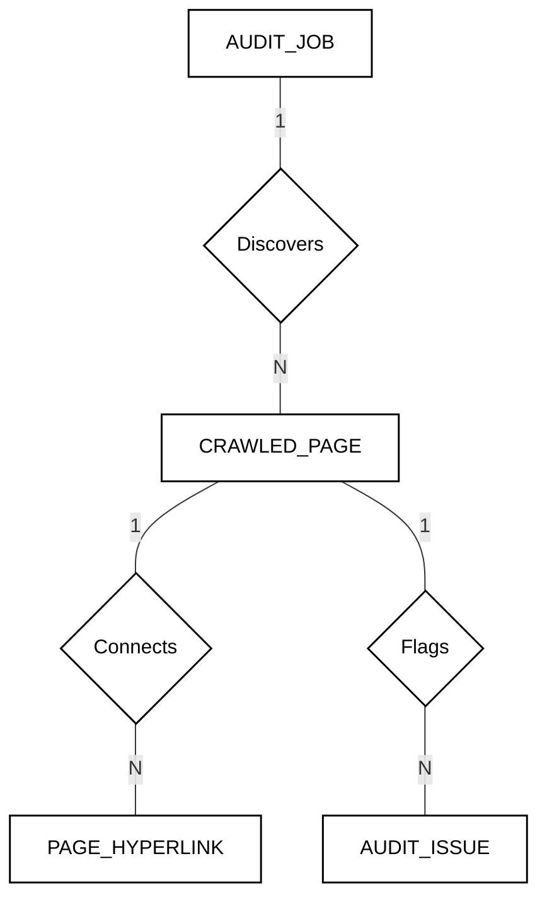
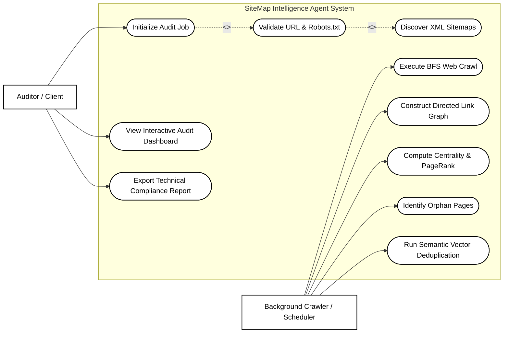
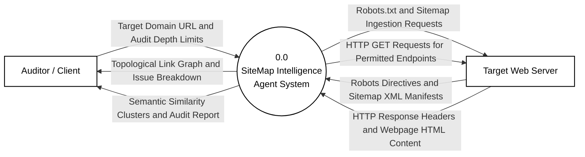
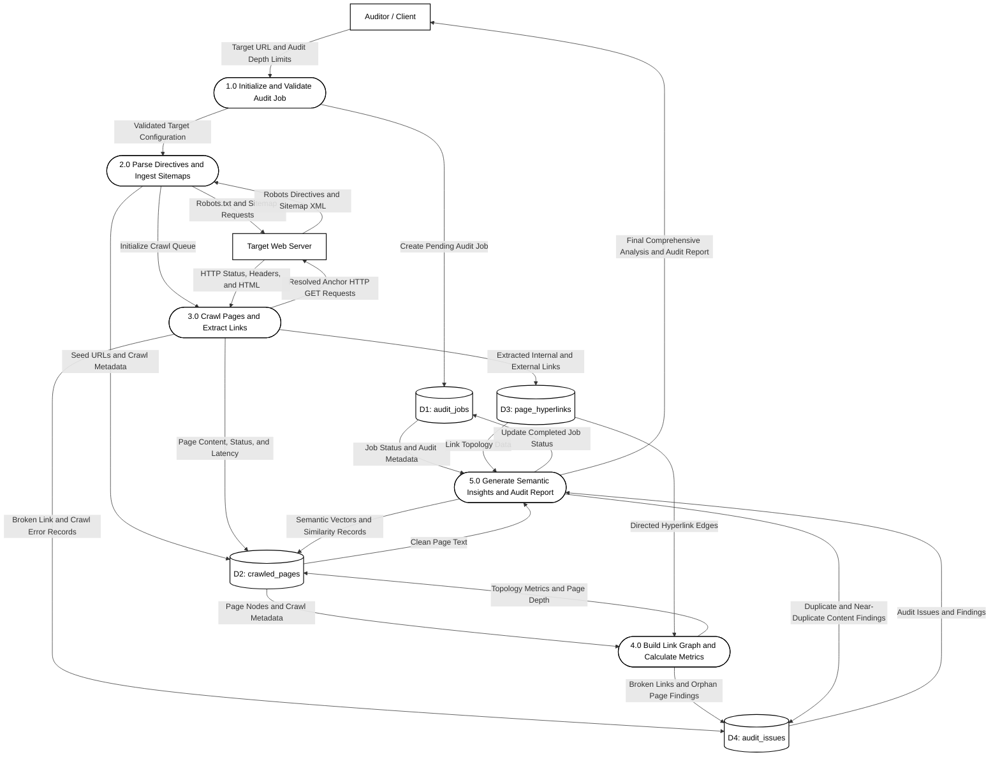

# CHAPTER 4: SYSTEM DESIGN

## 4.1 Entity-Relationship (E-R) Diagram
The following Chen-notation E-R diagram defines the relational and vector database models:

## 4.2 Use Case Diagram
Models interaction boundaries between the Auditor and the Background Engine:

## 4.3 Data Flow Diagram (Level 0 - Context Diagram)
Gane & Sarson DFD Level 0 defining external entities and data flows:

## 4.4 Data Flow Diagram (Level 1 - Functional Decomposition)
Detailed decomposition of Process 0.0 mapping to Data Stores D1 through D4:

